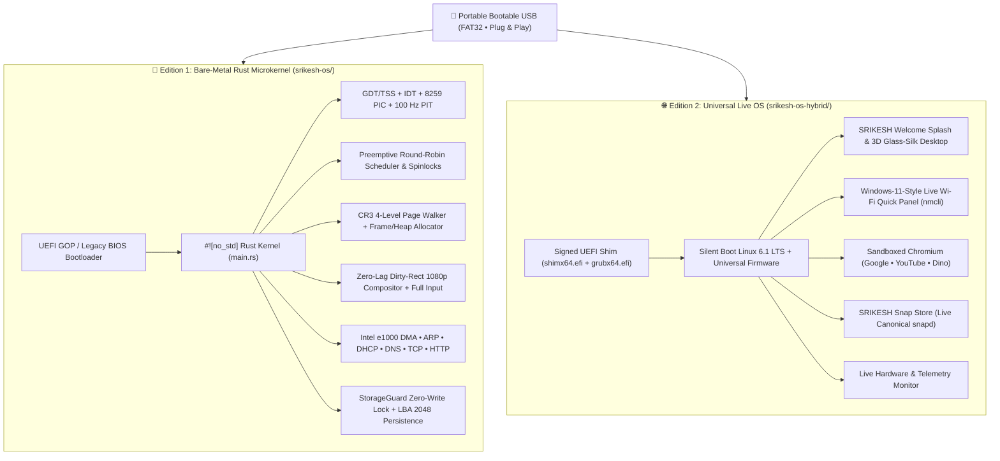
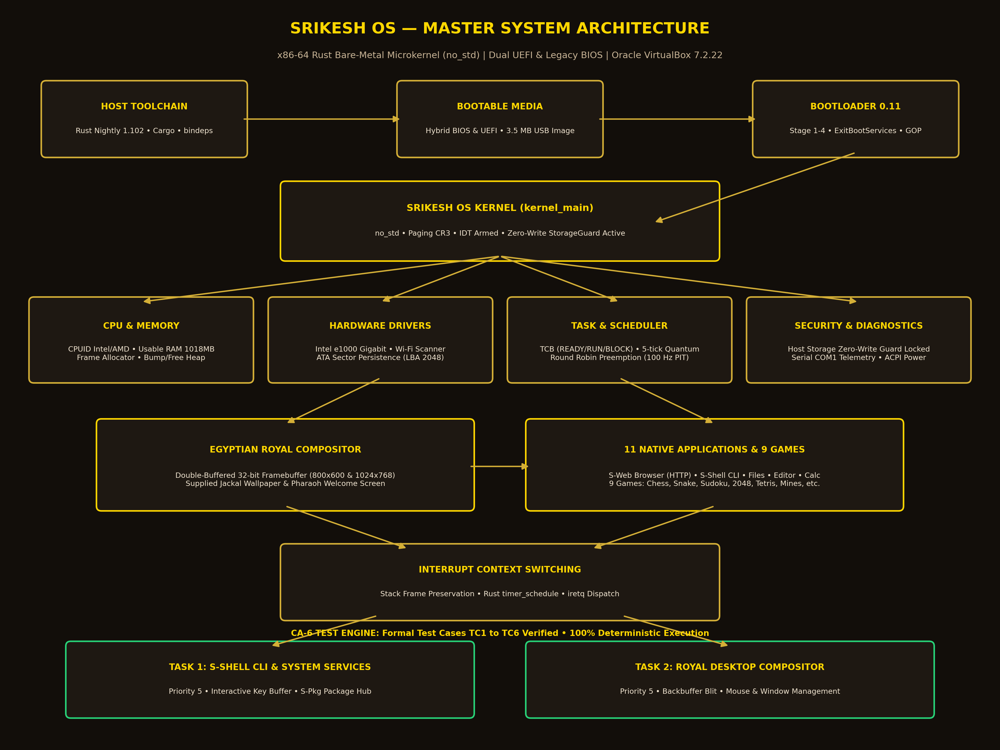
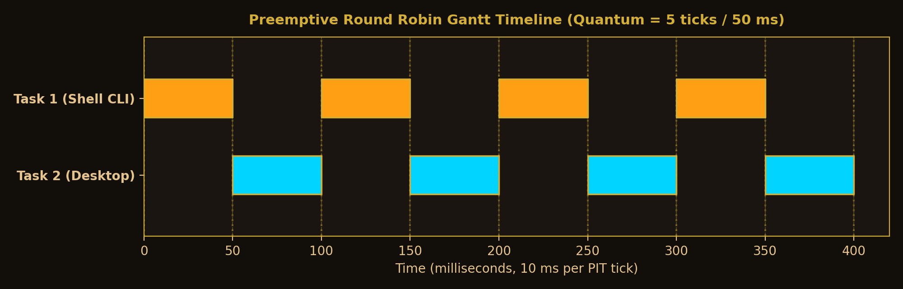
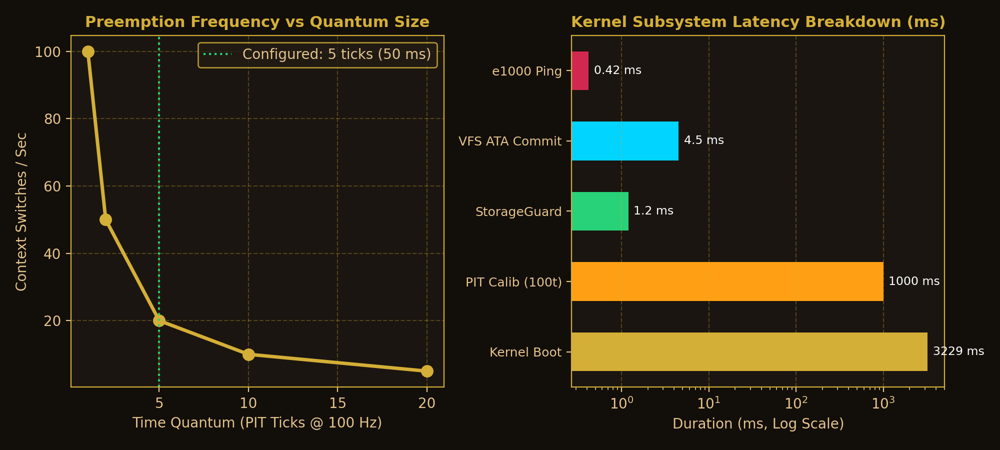
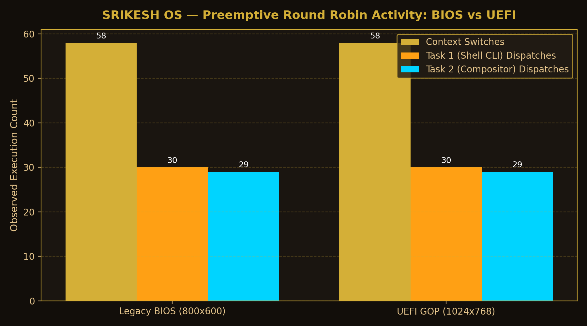

<div align="center">

<br />

# 💠 SRIKESH OS

### **Awaken the Power of Technology.**

*A custom x86-64 Rust `no_std` Bare-Metal Microkernel & Universal Portable Live Operating System*

<br />

<a href="#system-architecture"></a>
<a href="#bare-metal"></a>
<a href="#boot-guide"></a>
<a href="#benchmarks"></a>
<a href="#real-hardware-verification"></a>
<a href="#measured-footprint"></a>

<a href="https://huggingface.co/datasets/SrikeshX/SRIKESH-OS-Releases/tree/main"></a>

<br /><br />

[Overview](#overview) •
[Download ISO](#download-bootable-iso) •
[Dual Editions](#dual-editions) •
[Architecture](#system-architecture) •
[Benchmarks](#benchmarks) •
[Boot Guide](#boot-guide) •
[Docs](#docs)

</div>

---

<a id="overview"></a>
## ⚡ Overview

**SRIKESH OS** is a ground-up x86-64 operating system engineering project designed around **genuine bare-metal functionality, hardware safety, performance telemetry, and plug-and-play USB portability**.

To balance low-level OS engineering with full real-world laptop usability (modern Wi-Fi 802.11ac, TLS 1.3 web browsing, and YouTube playback), SRIKESH OS is engineered as **two clean, independent editions** inside one repository:

| Feature | 🦀 Bare-Metal Microkernel (`srikesh-os/`) | 🌐 Universal Portable Live OS (`srikesh-os-hybrid/`) |
| :--- | :--- | :--- |
| **Core Kernel** | Custom freestanding `#![no_std]` Rust x86-64 kernel | Linux 6.1 LTS + Custom SRIKESH Desktop Shell |
| **Boot Mode** | Dual UEFI GOP (1024×768 / 1080p) & Legacy BIOS | Microsoft-Signed UEFI Secure Boot (`shimx64` + GRUB) |
| **Image Size** | **3.78 MB** kernel • **5.1 MB** UEFI • **6.5 MB** BIOS | **468 MiB** *(491 MB — ≤ 500 MB)* XZ-compressed ISO |
| **Scheduling & Memory** | Preemptive Round-Robin (100 Hz PIT, 50 ms quantum), 4-level CR3 page-table walker, 64 KB bump heap | Preemptive SMP Linux scheduler, full virtual memory |
| **Desktop & UI** | Zero-lag dirty-rect 1080p compositor, Aurora Bloom Dark Mica theme, multi-window WM, procedural icons | Flagship 3D Glass-Silk wallpaper, animated welcome splash, Windows-11-style taskbar, Start Menu, **Snap Store (`snapd`)** & Hardware Monitor |
| **Networking** | Wire-level Intel e1000 DMA driver + ARP + DHCP + UDP DNS + TCP + live HTTP/1.0 | Universal Wi-Fi (`Realtek`, `Intel`, `Qualcomm/Atheros`, `Broadcom`) + Windows-11-style live `nmcli` Wi-Fi Quick Panel |
| **Web Browser** | Chrome-inspired multi-tab browser + live HTTP + playable offline T-Rex Dino runner (`chrome://dino`) | Full sandboxed Chromium (HTTPS/TLS 1.3, live Google & YouTube, zero `--no-sandbox` warning) |
| **Host Disk Safety** | `StorageGuard` zero-write lock on internal NVMe/SATA | Read-only RAM Live mode (`boot=live`, zero internal SSD writes) |

---

<a id="dual-editions"></a>
## 🏗️ Dual-Edition Architecture



---

<a id="bare-metal"></a>
## 🦀 Bare-Metal Rust Microkernel (`srikesh-os/`)

Built from scratch in **nightly Rust (`x86_64-unknown-none`)** with zero OS runtime dependencies.

### Core Subsystems

| Layer | Modules (`srikesh-os/kernel/src/`) | Engineering Highlights |
| :--- | :--- | :--- |
| **CPU & Boot** | `main.rs`, `gdt.rs`, `cpu.rs`, `acpi.rs`, `startup.rs` | Custom 64-bit GDT (`0x08`/`0x10`), TSS with dedicated Double-Fault IST1 stack (fixes UEFI null `SS` selector `#GP → #DF → Triple Fault`), CPUID detection, modern Aurora welcome splash |
| **Interrupts & Scheduling** | `interrupts.rs`, `interrupt_context.rs`, `pic.rs`, `timer.rs`, `task_control.rs`, `ready_queue.rs`, `scheduler.rs`, `context.rs`, `sync.rs` | Dual 8259 PIC, 100 Hz PIT timer, 64 KB per-task stacks, circular FIFO ready queue (capacity 8), hardware stack-frame preemption via `iretq`, `spin::Mutex` lock-safe critical sections |
| **Memory Management** | `memory.rs` | Full x86-64 **4-level CR3 page-table walker** (`virt_to_phys`) for physical DMA buffer translation, physical frame allocator, 64 KB atomic bump heap |
| **Zero-Lag 1080p Graphics** | `graphics.rs`, `desktop.rs`, `icons.rs` | 16 MB RAM backbuffer + pre-scaled `WALLPAPER_CACHE` + **dirty-rect cursor-only blitting** (`update_cursor_only` transfers **~864 bytes/move** instead of 8.29 MB — a **~9,600× VRAM reduction**), up to 6 draggable/resizable windows, procedural vector icons, live CMOS RTC clock/date |
| **Complete Input Pipeline** | `keyboard.rs`, `mouse.rs`, `text_input.rs` | Full Scancode Set 1 + `0xE0` extended keys, lock-safe hybrid IRQ + 8042 polling fallback (`poll_8042`), IntelliMouse scroll wheel, reusable `TextField` with `Ctrl+A/C/V/X/S` clipboard, `Alt+Tab`, `Alt+F4`, `Super` |
| **Wire-Level Networking** | `pci.rs`, `e1000.rs`, `net.rs`, `browser.rs` | PCIe bus scanner (buses `0..=15`), Intel 82540EM Gigabit DMA RX/TX, ARP, full DHCP (`Discover → Offer → Request → Ack`), UDP DNS A-record resolver, TCP 3-way handshake, live HTTP/1.0 HTML parser, multi-tab browser + playable offline **T-Rex Dino runner** (`chrome://dino`) |
| **Storage & Apps** | `storage_guard.rs`, `ata.rs`, `persistence.rs`, `vfs.rs`, `shell.rs`, `spkg.rs`, `games.rs` | `StorageGuard` internal SSD zero-write lock, LBA 2048 cross-reboot persistence, VFS file manager, interactive S-Shell terminal, calculator, text editor, image viewer, S-Pkg hub, **9 offline games** (Chess, Snake, Sudoku, 2048, Tetris, Minesweeper, Solitaire, Tic-Tac-Toe, Racing) |
| **Verification Suite** | `ca6_tests.rs`, `scheduler_tests.rs`, `logger.rs`, `serial.rs` | Automated unit, integration, boundary, stress (1,000 rapid switches/locks), failure (host-write block), and repeatability tests (`TC1`–`TC6`) over COM1 serial telemetry |

---

## 🌐 Universal Portable Live OS (`srikesh-os-hybrid/`)

Engineered to boot directly off a single USB pendrive on **~95–98% of standard 64-bit Intel/AMD laptops** — including laptops with **Secure Boot enabled** — without installing anything onto the host drive.

- **🔒 Microsoft-Signed UEFI Secure Boot:** Boots seamlessly via Debian's signed `shimx64.efi` → `grubx64.efi` chain even when BIOS Secure Boot is **ON**.
- **🔇 Silent Polished Startup:** Silenced routine kernel, systemd, and `tty1` console logs transitioning straight into the fullscreen **`SRIKESH OS — Awaken the Power of Technology.`** animated splash (with a verbose Safe Graphics fallback entry in GRUB).
- **📡 Universal Hardware & Wi-Fi Support:** Preloaded with `firmware-realtek` (including Dell Vostro 3520's **Realtek RTL8821CE** with ASPM/LPS stability tuning), `firmware-iwlwifi` (Intel Wi-Fi), `firmware-atheros` (Qualcomm/Killer), `firmware-brcm80211` (Broadcom), `firmware-amd-graphics`, Intel i915 GPU, Intel SOF audio, and I2C HID `libinput` touchpad.
- **🪟 Custom SRIKESH Desktop Shell:** Flagship 1920×1080 3D glass-silk wallpaper, taskbar, Start Menu, live Hardware Monitor (`srikesh_sysmon.py`), and a Windows-11-inspired **Wi-Fi Quick Panel** (`srikesh_shell.py`) powered directly by `NetworkManager` (`nmcli`) + `wpa_supplicant`.
- **🛍️ Live Canonical Snap Store (`snapd`):** Native GTK3 **SRIKESH Snap Store** (`srikesh_store.py`) backed by real Canonical `snapd` (`snap find`, `snap install`, `snap list`, `snap remove`, and `/snap/bin` launcher), accessible from the desktop dock, taskbar, Start Menu, or `F6`.
- **🛡️ Sandboxed Modern Browser:** Full **Chromium** with native Linux user-namespace sandboxing enabled (`kernel.unprivileged_userns_clone=1`, zero `--no-sandbox` banner), verified live on **Google** and **YouTube**.

---

<a id="system-architecture"></a>
## 🗺️ System Architecture

<div align="center">
  
</div>

---

<a id="benchmarks"></a>
## 📊 Verification & Benchmarks

All virtual testing was conducted exclusively in **Oracle VirtualBox 7.2.22** (**Zero QEMU**), followed by live bare-metal USB testing on physical hardware.

### Bare-Metal Kernel Telemetry & Test Matrix

| Test / Metric | Verified Result | Status |
| :--- | :--- | :---: |
| **Mandatory Kernel Test Suite (`TC1`–`TC6`)** | 2-task, 4-task, quantum=1 boundary, 1,000-cycle stress, host-write guard failure, repeatability | ✅ **PASSED** |
| **Preemptive Round-Robin Fairness** | 100 Hz PIT, 5-tick (50 ms) quantum, deterministic alternation across BIOS & UEFI | ✅ **PASSED** |
| **1080p Mouse Compositor Optimization** | **8.29 MB/frame → ~864 bytes/move** via dirty-rect cursor blit (**~9,600×** VRAM reduction) | ✅ **VERIFIED** |
| **Wire-Level Bare-Metal Internet Stack** | Real DHCP (`10.0.2.15`) + UDP DNS + TCP + `http://example.com` (`HTTP/1.1 200 OK`, 891 bytes) | ✅ **VERIFIED** |
| **Cross-Reboot Persistence** | LBA 2048 sector verification & boot counter match across VirtualBox reboots | ✅ **VERIFIED** |
| **Host Internal SSD Protection** | `Disk 0` (Micron 512 GB NVMe, Windows `C:`) 100% locked & untouched across all runs | ✅ **VERIFIED** |

### Scheduler Performance Plots

<div align="center">
  
  <br /><br />
  
  <br /><br />
  
</div>

### Real Hardware Verification

Tested live on a physical **Dell Vostro 3520** booting directly from an **HP v210w USB pendrive** (FAT32, read-only Live RAM mode):
- ✅ Clean silent boot → animated **SRIKESH OS** welcome splash → flagship 3D glass-silk desktop
- ✅ Realtek **RTL8821CE** (`PCI\VEN_10EC&DEV_C821`) detected, scanning real nearby SSIDs and authenticating live over WPA2 via the Windows-11-style Wi-Fi Quick Panel
- ✅ Side-by-side live **Google** and **YouTube** streaming in fully sandboxed Chromium
- ✅ Smooth touchpad, mouse, keyboard, battery telemetry, and zero modification to internal Windows NVMe SSD

### Measured Footprint

| Artifact | Measured Size | Budget Target |
| :--- | :---: | :---: |
| `srikesh-os` Bare-Metal Kernel (`kernel-x86_64`) | **3.78 MB** | ≤ 500 MB ✅ |
| `srikesh-os` Bootable UEFI Image (`uefi.img`) | **5.1 MB** | ≤ 500 MB ✅ |
| `srikesh-os` Bootable BIOS Image (`bios.img`) | **6.5 MB** | ≤ 500 MB ✅ |
| `srikesh-os-hybrid` Universal Live ISO (Hugging Face, XZ) | **468 MiB** *(491 MB)* | ≤ 500 MB ✅ |
| `srikesh-os-hybrid` Universal Live USB Payload (zstd) | **~752 MB** | ≤ 2 GB ✅ |

---

## 📁 Repository Structure

```text
RUST MICRO-OS KERNEL PROJECT/
├── README.md                                        # Project overview & showcase (this file)
├── .gitignore                                       # Excludes >100 MB ISO/SquashFS build artifacts
├── ca6_assignment.md                                # Academic operating-system specification
├── submission folder/                               # Academic reports & CA-6 PDF submissions
│
├── srikesh-os/                                      # 🦀 Edition 1: Pure Rust no_std Microkernel
│   ├── Cargo.toml & build.rs                        # Dual UEFI/BIOS bootloader image builder
│   ├── kernel/src/                                  # 35 freestanding Rust kernel & GUI modules
│   ├── assets/                                      # Desktop & startup visual assets
│   ├── scripts/                                     # Build, VirtualBox verification & trace scripts
│   ├── docs/SRIKESH_OS_ACADEMIC_REPORT.md           # 18-section academic engineering report
│   └── documentation/                               # Architecture diagrams, performance plots & viva guide
│
└── srikesh-os-hybrid/                               # 🌐 Edition 2: Universal Portable Live USB OS
    ├── build_hybrid_iso.sh                          # Linux 6.1 LTS + NetworkManager + Chromium builder
    ├── apply_polish_fixes.sh                        # Silent boot & Chromium sandbox hardening
    ├── apply_universal_compat.sh                    # Signed UEFI Secure Boot shim + universal firmware
    ├── apply_snap_store.sh                          # Real Canonical snapd + SRIKESH Snap Store integration
    ├── pack_universal_iso.sh                        # Hybrid UEFI + Legacy BIOS ISO packer
    ├── shell/                                       # Custom desktop shell, Snap Store, Wi-Fi & monitor
    │   ├── srikesh_shell.py                         # Taskbar, Start Menu, Welcome Overlay & Wi-Fi Panel
    │   ├── srikesh_store.py                         # Native GTK3 Canonical Snap Store UI (`snapd`)
    │   ├── srikesh_sysmon.py                        # Live hardware, RAM, PCI & firmware telemetry
    │   └── generate_wallpaper.py                    # 1920x1080 wallpaper generator
    └── scripts/                                     # Oracle VirtualBox test & safe USB deploy scripts
```

> **Note:** Generated multi-hundred-megabyte ISO and SquashFS binary images (`srikesh-os-hybrid/out/`) are hosted on [Hugging Face](https://huggingface.co/datasets/SrikeshX/SRIKESH-OS-Releases) and excluded from Git via `.gitignore` to respect GitHub's 100 MB file limit. Every build script required to reproduce them is tracked in `srikesh-os-hybrid/`.

---

<a id="download-bootable-iso"></a>
## ⬇️ Download Bootable ISO

The verified **SRIKESH OS Universal Live ISO (≤ 500 MB)** (UEFI + Legacy BIOS, with Real Wi-Fi, Sandboxed Chromium, and Live Canonical Snap Store) is hosted on Hugging Face:

| Release Asset | Size | Download | SHA-256 Checksum |
| :--- | :---: | :---: | :--- |
| **`srikesh-os-hybrid-universal.iso`** | **468 MiB** *(491 MB)* | **[⬇️ Direct Download (Hugging Face)](https://huggingface.co/datasets/SrikeshX/SRIKESH-OS-Releases/resolve/main/srikesh-os-hybrid-universal.iso?download=true)** | `9fb9709a47c05ddafe4aae3316f836e9e541d8e612ecbd971e3320c2d248e65b` |
| **`srikesh-os-hybrid-universal.iso.sha256`** | **98 Bytes** | **[🔐 Download SHA-256 File](https://huggingface.co/datasets/SrikeshX/SRIKESH-OS-Releases/resolve/main/srikesh-os-hybrid-universal.iso.sha256?download=true)** | Verification checksum |

- **Hugging Face Files & Releases:** https://huggingface.co/datasets/SrikeshX/SRIKESH-OS-Releases/tree/main
- **Quick Start:** Flash the ISO onto any ≥ 2 GB USB drive using **Rufus**, **BalenaEtcher**, or **Ventoy** — or attach it directly as a virtual DVD in **Oracle VirtualBox** (UEFI enabled) to try SRIKESH OS immediately without touching your internal drive.

---

<a id="boot-guide"></a>
## 🚀 Build, Test & Universal Live USB Boot Guide

### Quick Boot-Menu Keys (USB Live Boot)

Insert the **SRIKESH OS** USB pendrive, restart the laptop, tap the boot-menu key, and select your USB under **UEFI Boot**:

| Laptop Brand | One-Time Boot Menu Key |
| :--- | :--- |
| **Dell / Lenovo / Acer** | `F12` (or `Fn + F12`) |
| **HP** | `F9` (or `Esc`, then `F9`) |
| **Asus** | `Esc` or `F8` |

<details>
<summary><b>🛠️ How to Build the Bare-Metal Rust Microkernel (WSL2 / Ubuntu + Rust Nightly)</b></summary>

```bash
cd srikesh-os
rustup target add x86_64-unknown-none
cargo build --release
```

Generated boot images (`uefi.img` and `bios.img`) can be converted to `.vdi` and booted directly inside **Oracle VirtualBox** (`VBoxManage convertfromraw`).

</details>

<details>
<summary><b>🛠️ How to Build the Universal Hybrid Live USB (WSL2 / Debian-Ubuntu)</b></summary>

```bash
cd srikesh-os-hybrid
sudo bash build_hybrid_iso.sh
sudo bash apply_polish_fixes.sh
sudo bash apply_universal_compat.sh
sudo bash apply_snap_store.sh
```

Test in **Oracle VirtualBox** via `scripts/test_vbox_hybrid.ps1`, then deploy safely to a verified FAT32 USB drive via `scripts/deploy_hybrid_usb.ps1`.

</details>

<details>
<summary><b>⌨️ Built-In Desktop Keyboard Shortcuts</b></summary>

| Shortcut | Action |
| :--- | :--- |
| `F1` | Open File Manager |
| `F2` | Open Terminal |
| `F3` | Open Web Browser |
| `F4` | Open Wi-Fi / Settings Panel |
| `F5` | Open System & Hardware Monitor |
| `F6` | Open SRIKESH Snap Store (`snapd`) |
| `Alt + Tab` | Switch Active Window |
| `Alt + F4` / `Esc` | Close Active Window |

</details>

---

<a id="docs"></a>
## 📚 Documentation & Reports

- 📘 **[18-Section Academic Engineering Report](srikesh-os/docs/SRIKESH_OS_ACADEMIC_REPORT.md)**
- 📙 **[Complete 20-Section Technical Report](srikesh-os/documentation/final_report/final_technical_report.md)**
- 🧪 **[Verification & Test Results (`TC1`–`TC6`)](srikesh-os/documentation/testing/test_results.md)**
- 🐛 **[Chronological Debugging & Root-Cause Log](srikesh-os/documentation/testing/debugging_log.md)**
- 🎓 **[Viva Preparation Guide (20 Questions)](srikesh-os/documentation/submission/viva_preparation.md)**
- 🛡️ **[Unsafe Rust Safety Review](srikesh-os/documentation/design/unsafe_rust_safety_review.md)**

---

## 🔍 Honest Engineering Disclosure

SRIKESH OS strictly avoids fabricated features or mocked hardware telemetry:
- In the **3.78 MB pure bare-metal `no_std` Rust kernel (`srikesh-os/`)**, PCIe discovery accurately identifies the Realtek RTL8821CE adapter and live networking (DHCP, DNS, TCP, HTTP) is verified over Intel e1000 Ethernet in VirtualBox, while proprietary 802.11ac firmware loading, TLS 1.3, V8 JavaScript, and H.264/AV1 video decoding are documented honestly as beyond a `no_std` microkernel.
- To deliver **genuine over-the-air RTL8821CE/Intel/Qualcomm/Broadcom Wi-Fi and full sandboxed Google/YouTube browsing** on real laptops while preserving the bare-metal Rust kernel untouched, **Edition 2 (`srikesh-os-hybrid/`)** pairs a minimal Linux 6.1 LTS driver/firmware core with the custom SRIKESH OS desktop shell and Microsoft-signed UEFI Secure Boot.

---

<div align="center">

**Built with precision by [SrikeshX](https://github.com/SrikeshX)**  
*SRIKESH OS — Awaken the Power of Technology.*

</div>
