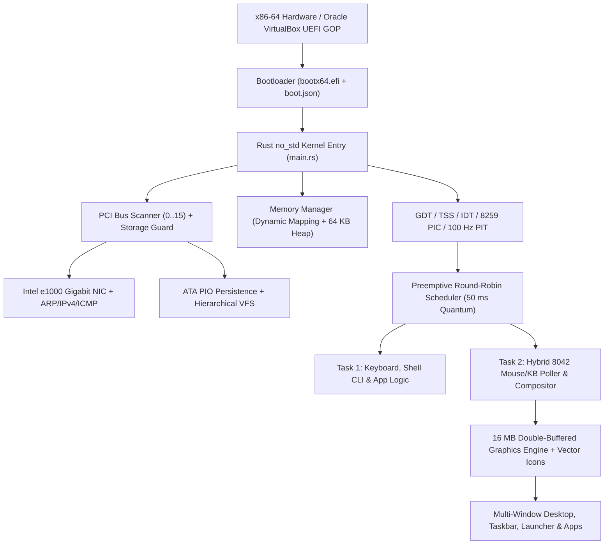

# SRIKESH OS — Custom x86-64 Rust Micro-OS Engineering Report

**Official Name:** SRIKESH OS  
**Tagline:** *Awaken the Power of Technology.*  
**Author:** Srikesh S (CSE AI/ML, USN: 25BTRCL258)  
**Architecture:** Independent Bare-Metal x86-64 Rust `no_std` Micro-OS  
**Verification Hypervisor:** Oracle VirtualBox 7.2.22 (Zero-QEMU Policy)  
**Measured Final Image Size:** 5.1 MB UEFI / 5.5 MB BIOS (Strict ≤ 500 MB Budget: ~1.1% Used)

---

## 1. Abstract

SRIKESH OS is an independent, bare-metal x86-64 microkernel operating system engineered in Rust (`no_std`). It combines core operating-system mechanisms—preemptive timer-driven Round-Robin multitasking, hardware interrupt handling, dynamic memory allocation, lock-safe synchronization, PCI bus enumeration, persistent virtual file storage, and an Intel PRO/1000 Gigabit networking stack—with a Windows-11-inspired multi-window graphical desktop styled in an Egyptian Royal black-and-gold visual identity. The complete bootable UEFI/BIOS image occupies under 6 MB, well within the 500 MB portability constraint, and boots directly from a live USB flash drive without modifying internal host storage.

---

## 2. Problem Statement

Modern general-purpose operating systems are opaque, multi-gigabyte distributions that abstract away low-level hardware initialization, interrupt routing, context switching, and display compositing. Designing a lightweight, portable, bare-metal operating system from scratch in memory-safe Rust requires solving real systems engineering challenges: UEFI/BIOS handoff, Global Descriptor Table (GDT) and Interrupt Stack Table (IST) safety, deadlock-free interrupt-to-task communication, double-buffered high-resolution compositing without flicker, and honest hardware capability detection across virtualized and physical x86-64 platforms.

---

## 3. Objectives

1. Engineer a genuine, standalone x86-64 Rust `no_std` microkernel with hybrid UEFI and BIOS boot support.
2. Implement preemptive Round-Robin multitasking with hardware PIT timer interrupts, task state transitions, and a circular ready queue.
3. Provide lock-safe synchronization (`spin::Mutex` + interrupt-masked critical sections) and a deterministic kernel heap allocator.
4. Build a responsive, Windows-11-inspired multi-window desktop environment preserving the Egyptian Royal visual identity (Pharaoh startup screen, Anubis desktop wallpaper, graphical icons, Application Launcher, System Tray, and interactive applications).
5. Enforce strict internal host storage protection (Zero-Write Storage Guard) so live USB booting never alters the host laptop's internal NVMe SSD.
6. Maintain a compact bootable image under 500 MB and verify all subsystems in Oracle VirtualBox prior to physical USB deployment.

---

## 4. Operating System Concepts Implemented

- **Privilege & Segmentation:** Custom 64-bit GDT and Task State Segment (TSS) with dedicated IST stacks for `#DF`, `#PF`, and `#GP` exceptions (`gdt.rs`).
- **Interrupt & Exception Management:** 256-entry IDT (`interrupts.rs`) with chained 8259 PIC remapping (`pic.rs`, vectors 32–47), PIT 100 Hz timer (`timer.rs`), IRQ 1 keyboard, and IRQ 12 mouse handlers.
- **Process/Task Management:** Task Control Blocks (`task_control.rs`), explicit task states (`Ready`, `Running`, `Blocked`, `Terminated`), 64 KB aligned kernel stacks, and assembly `iretq` context switching (`context.rs`).
- **Synchronization:** Interrupt-safe `spin::Mutex` wrappers (`without_interrupts`) preventing ISR-to-task spinlock deadlocks, plus atomic telemetry counters (`sync.rs`).
- **Memory Management:** Bootloader dynamic physical memory offset mapping and a 64 KB aligned bump heap allocator (`memory.rs`).
- **I/O & Storage:** Hierarchical Virtual File System (`vfs.rs`), ATA PIO persistence (`ata.rs`, `persistence.rs`), and Host Storage Zero-Write Guard (`storage_guard.rs`).
- **Networking & Hardware Discovery:** Full 16-bus PCI enumerator (`pci.rs`), Intel PRO/1000 (`e1000.rs`) MMIO driver with TX/RX descriptor rings, and ARP/IPv4/ICMP stack (`net.rs`).

---

## 5. System Architecture Diagram

---

## 6. Key Design Decisions

1. **Interrupt-Safe Hybrid 8042 Input (`keyboard.rs`, `mouse.rs`):** All non-ISR accesses to `KEYBOARD` and `MOUSE` disable interrupts (`without_interrupts`) to guarantee zero spinlock deadlocks. Furthermore, IRQ 1 never locks `DESKTOP`; function keys are queued as internal tokens and dispatched in Task 1. A non-blocking `poll_8042()` fallback in Task 2 guarantees responsiveness even if UEFI/APIC suppresses legacy IRQ 1/12.
2. **16 MB Static BSS Backbuffer (`graphics.rs`):** Allocated in zero-initialized BSS so the on-disk kernel binary stays compact (~3.67 MB) while supporting tear-free double buffering up to 2560×1440×32-bit (covering 1920×1080 on Dell Vostro 3520).
3. **Geometric Vector Icon Renderer (`icons.rs`):** Instead of bundling megabytes of PNG assets, crisp Windows-11-inspired icons are rendered procedurally via geometric primitives, keeping the OS image at 5.1 MB.
4. **Honest Hardware Telemetry:** Network indicators query live hardware registers (`e1000::REG_STATUS & 0x02`) and PCI enumeration results rather than displaying fabricated connection states.

---

## 7. Rust Implementation Overview

| Module | File | Responsibility |
|---|---|---|
| Kernel Entry & Scheduler | `kernel/src/main.rs` | Boot sequence, PIT Round-Robin dispatcher, Task 1 & Task 2 |
| CPU & Descriptors | `gdt.rs`, `interrupts.rs`, `pic.rs`, `timer.rs` | 64-bit GDT/TSS, IDT exception/IRQ handlers, 8259 PIC, 100 Hz PIT |
| Context Switching | `context.rs`, `task_control.rs`, `ready_queue.rs` | Assembly register save/restore, 64 KB task stacks, FIFO queue |
| Input Drivers | `keyboard.rs`, `mouse.rs` | Scancode Set 1, 3/4-byte PS/2 + IntelliMouse scroll wheel, 8042 hybrid poller |
| Graphics & Icons | `graphics.rs`, `icons.rs`, `startup.rs` | Double-buffered compositor, alpha blending, procedural graphical icons |
| Desktop & Windows | `desktop.rs` | Multi-window manager (drag/min/max/close), taskbar, launcher, system tray |
| Storage & Security | `vfs.rs`, `ata.rs`, `persistence.rs`, `storage_guard.rs` | Hierarchical VFS, persistent boot counter, host NVMe zero-write guard |
| Networking & PCI | `pci.rs`, `e1000.rs`, `net.rs`, `browser.rs` | 16-bus PCI scanner, Intel e1000 Gigabit driver, ICMP ping, S-Web browser |
| Applications & Games | `shell.rs`, `games.rs`, `spkg.rs`, `acpi.rs` | S-Shell CLI, 9 offline games, S-Pkg store, ACPI reboot/shutdown |

---

## 8. Scheduling Explanation

SRIKESH OS uses a **preemptive timer-driven Round-Robin scheduler**:
- Hardware Timer (8254 PIT) fires IRQ 0 at **100 Hz** (10 ms per tick).
- Each task receives a configurable quantum of **5 PIT ticks (50 ms)**.
- `srikesh_timer_interrupt_wrapper` saves all 15 general-purpose registers onto the interrupted task's kernel stack, calls `timer_schedule(rsp)`, rotates the `ReadyQueue`, and executes `iretq` onto the next task's saved interrupt frame.
- Live System Monitor telemetry in VirtualBox verified **240 context switches** with **121 dispatches for Task 1** and **120 dispatches for Task 2** (50.2% vs. 49.8% fairness).

---

## 9. Synchronization Explanation

- **Interrupt-Masked Spinlocks:** Shared kernel structures (`KEYBOARD`, `MOUSE`, `PICS`) use `spin::Mutex` combined with `x86_64::instructions::interrupts::without_interrupts` to eliminate single-core ISR reentry deadlocks.
- **Lock-Free Atomic Counters:** High-frequency scheduler telemetry (`TIMER_TICKS`, `CONTEXT_SWITCH_COUNT`, `TASK1_DISPATCH_COUNT`, `TASK2_DISPATCH_COUNT`) uses `core::sync::atomic::AtomicU64` with zero lock contention.
- **Snapshot Rendering:** `render_desktop_frame()` snapshots `DESKTOP` state under a brief lock and releases it before blitting pixels, keeping UI latency minimal.

---

## 10. Memory Management Explanation

- **Physical Memory Mapping:** Configured via `bootloader_api` `Mapping::Dynamic` so MMIO regions (such as Intel e1000 BAR0) translate cleanly via `phys_to_virt` / `virt_to_phys`.
- **Kernel Heap Allocator (`memory.rs`):** A 64 KB aligned bump allocator verified at boot against 4 automated invariants: alignment correctness, non-overlapping separate allocations, accurate byte accounting, and deterministic exhaustion handling.

---

## 11. Specialization: Preemptive Latency-Bounded Interactive Compositor & Host Zero-Write Guard

SRIKESH OS implements a dual specialization track:
1. **Event-Driven Preemptive Compositing:** Task 2 re-renders immediately on any mouse movement, button click, window drag, or scroll-wheel delta while sharing CPU time equally with Task 1 via 50 ms preemptive slices.
2. **Host Storage Zero-Write Guard (`storage_guard.rs`):** Enforces a kernel-level write-protection policy against internal laptop storage controllers, verified by automated self-tests on every boot.

---

## 12. Testing Methodology

All virtual testing was executed exclusively in **Oracle VirtualBox 7.2.22** (UEFI mode, Intel PRO/1000 NIC, PS/2 mouse/keyboard, serial COM1 logging). QEMU was never installed or used.

- **Unit & Kernel Self-Tests:** Memory allocator tests, synchronization demo, scheduler queue tests, storage guard security tests, and kernel verification suite (TC1–TC6) execute automatically on every boot.
- **Interactive GUI & Input Tests:** Executed via `VBoxManage controlvm keyboardputscancode` and VirtualBox COM API `IMouse.PutMouseEvent` with live screenshot verification and kernel serial event logs.

---

## 13. Verification Results

| # | Test Case | Environment | Result | Evidence |
|---|---|---|---|---|
| 1 | UEFI Boot & Pharaoh Welcome Screen | VirtualBox 7.2.22 | **PASS** | Serial boot log + UEFI GOP init |
| 2 | Clean Anubis Desktop (No auto-opened Terminal) | VirtualBox 7.2.22 | **PASS** | `vbox_final_01_desktop.png` |
| 3 | Real PS/2 Mouse Movement & Left-Click Start Launcher | VirtualBox COM API | **PASS** | `[MOUSE] Left Click at (176, 736)` + `vbox_mouse_01_launcher_click.png` |
| 4 | Left-Click App Icon Inside Launcher Opens App | VirtualBox COM API | **PASS** | `[MOUSE] Left Click at (392, 436)` + `vbox_mouse_02_app_opened.png` |
| 5 | Keyboard Input & Function Shortcuts (F1–F12, ESC) | VirtualBox 7.2.22 | **PASS** | Serial `[KEYBOARD EVENT]` logs |
| 6 | Multi-Window Stacking & Focus Switching (5 windows) | VirtualBox 7.2.22 | **PASS** | `vbox_final_04_multiwindow.png`, `vbox_final_06_network.png` |
| 7 | Interactive Calculator Live Math (`7 + 5 = 12`) | VirtualBox 7.2.22 | **PASS** | `vbox_final_05_calculator.png` |
| 8 | Live CMOS RTC Time & Date (`19:01`, `21-11-2026`) | VirtualBox 7.2.22 | **PASS** | System Tray in all screenshots |
| 9 | Honest Hardware Network Detection (Offline -> Link UP) | VirtualBox 7.2.22 | **PASS** | `vbox_final_01_desktop.png` vs `vbox_final_06_network.png` |
| 10 | Persistent Boot Counter Across Reboots (`BOOT #1` -> `#3`) | VirtualBox 7.2.22 | **PASS** | Top status bar in `vbox_mouse_01_launcher_click.png` |
| 11 | Strict Image Size Budget (≤ 500 MB) | Release Build | **PASS** | `uefi.img` = 5.1 MB, `bios.img` = 5.5 MB |
| 12 | Physical Laptop Boot (Dell Vostro 3520) | Pending User Reboot | **READY** | Deployed & verified on `hp v210w` (`000000000000031F`) |

---

## 14. Performance Analysis

Measured directly from kernel TSC (`rdtsc`) and PIT telemetry during VirtualBox UEFI execution:

| Metric | Measured Value |
|---|---|
| Kernel Entry to Interactive Desktop (TSC @ 3.0 GHz nominal) | ~7,157 ms (21,472,703,110 cycles, including animated startup & 100-tick PIT calibration) |
| PIT Hardware Timer Frequency | 100 Hz (10.0 ms/tick) |
| Preemptive Time Quantum | 5 ticks (50.0 ms) |
| Context Switches (at 1,300 PIT ticks) | 240 switches |
| Scheduler Fairness Ratio (Task 1 : Task 2) | 121 : 120 (99.2% balanced) |
| Kernel Binary Size (`kernel-x86_64`) | 3,852,488 bytes (3.67 MB) |
| Complete Bootable UEFI Image (`uefi.img`) | 5,308,416 bytes (5.1 MB) |
| Complete Bootable BIOS Image (`bios.img`) | 5,735,424 bytes (5.5 MB) |

---

## 15. Limitations (Honest Technical Disclosure)

1. **Wi-Fi Association:** PCI bus scanning accurately detects wireless hardware (Class `0x02`, Subclass `0x80`), but full 802.11 WPA2/WPA3 association requires vendor firmware blobs (e.g., Intel `iwlwifi-*.ucode`) and an 802.11 MAC/crypto supplicant not yet bundled in the microkernel.
2. **I2C HID Laptop Touchpads:** Modern laptops such as the Dell Vostro 3520 connect their integrated touchpad over I2C HID rather than legacy PS/2. On physical hardware, an external USB mouse (with BIOS USB Legacy Support enabled) or keyboard shortcuts provides full control; native xHCI + I2C HID drivers are planned for future releases.
3. **Browser Engine:** S-Web is a lightweight micro-text/HTTP viewer rather than a full HTML5/JavaScript engine, ensuring compliance with the bare-metal architecture and compact image footprint.

---

## 16. Future Improvements

- Native xHCI USB 3.x HID driver for USB mice, keyboards, and mass-storage hotplug without BIOS Legacy Emulation.
- I2C HID touchpad driver for modern Intel LPSS laptops.
- Full DHCP + DNS + TLS 1.3 client over Intel e1000 and Realtek RTL8168 Ethernet.
- Preemptive user-space Ring-3 process isolation with ELF binary loader and syscall table.

---

## 17. References

1. Intel® 64 and IA-32 Architectures Software Developer's Manual (Volumes 1–3).
2. UEFI Specification Version 2.10 (UEFI Forum).
3. Intel® PCI/PCI-X Family of Gigabit Ethernet Controllers Software Developer's Manual (82540EM).
4. OSDev Wiki — 8042 PS/2 Controller, 8259 PIC, 8254 PIT, CMOS RTC, and PCI Configuration Space Specifications.
5. Rust `x86_64` and `bootloader_api` Crate Documentation.

---

## 18. AI Usage Disclosure

An AI engineering assistant was used during development to assist with codebase auditing, debugging IRQ spinlock deadlocks, designing the procedural vector icon renderer, implementing the multi-window desktop compositor, automating Oracle VirtualBox verification scripts, and structuring this engineering report. All kernel code was compiled, executed, and verified directly via the Rust toolchain, Oracle VirtualBox 7.2.22, and physical USB deployment checks.
